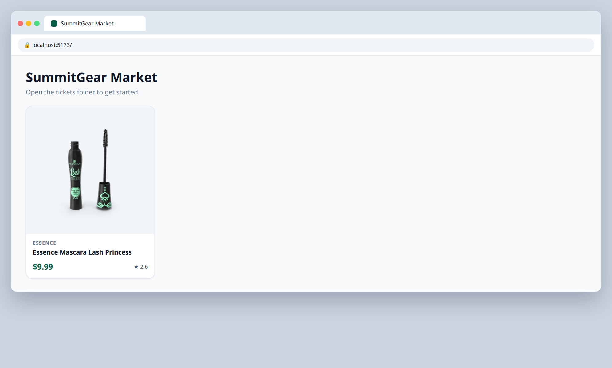

# 1.1 — Build the ProductCard component

**Labels:** feature, components, props, day-1

## Branch
Before starting, create your branch:
```
git checkout -b product-card
```

## Description
Every store needs a product card. Build a `ProductCard` component that takes **one product as a prop** and displays it.

The `Product` type is already written for you in `src/types/product.ts`, and 30 sample products live in `src/data/products.ts`. Open both and look at what fields a product has before you start.

For now, render **one** card in `App.tsx` by passing in `products[0]`. Ticket 1.2 renders the rest.

## Where the data comes from
Product data lives in a local file that's already in the repo: **`src/data/products.ts`** (30 products).
Import it in `App.tsx`:
```ts
import { products } from "./data/products";
```
Each product's shape is the `Product` type in **`src/types/product.ts`** — import it wherever you need to type a prop:
```ts
import type { Product } from "../types/product";
```
You'll keep using this file through Day 4. On Day 5 (ticket 5.1) you'll swap it for a real API call.

## Where your files go
```
src/
├── components/
│   └── ProductCard.tsx   ◀━━ ★ NEW: create this file
├── data/
│   └── products.ts       (already here, don't change it)
├── types/
│   └── product.ts        (already here, don't change it)
└── App.tsx               ◀━━ ✎ EDIT: change this file
```
> **★ NEW** = create this file  ·  **✎ EDIT** = change a file that already exists  ·  `...` = your other components from earlier tickets

## Mock
Match the layout and pieces. Exact colors and spacing are up to you, but keep it consistent with your earlier tickets.

**One card rendered in App**



## Acceptance Criteria
- [ ] `src/components/ProductCard.tsx` exists and exports a `ProductCard` component
- [ ] Props are typed — the component accepts `{ product: Product }` (no `any`)
- [ ] Card shows the thumbnail image (with `alt` text), title, brand (only if it has one), price and rating
- [ ] Price is formatted as currency, e.g. `$9.99`
- [ ] Card is styled with Tailwind (border or shadow, rounded corners, padding)
- [ ] `App.tsx` renders one `ProductCard` using `products[0]`

## Hints
- Type a prop object like this: `function ProductCard({ product }: { product: Product })`
- `brand` is optional (`brand?: string`). Use `&&` to only render it when it exists.
- `price.toFixed(2)` gives you two decimal places.

## Submit
When your acceptance criteria are all checked off:
```
git add .
git commit -m "your message here"
git push origin product-card
```
Your commit message should summarize what you actually changed (not just "done" or "fix") — write it like you're telling a teammate what this branch does.

Then open a Pull Request on your own fork's GitHub page (base: your `main`, compare: your branch) and add **your-instructor-github-username** as a reviewer.
