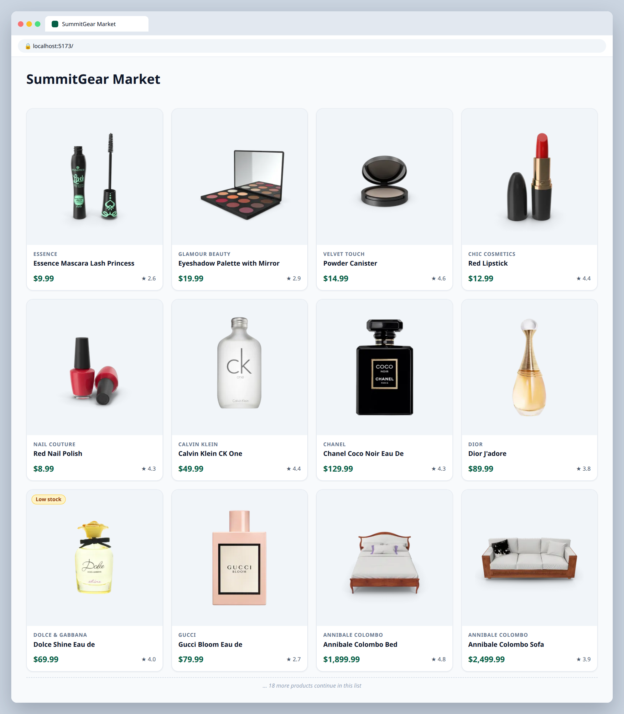
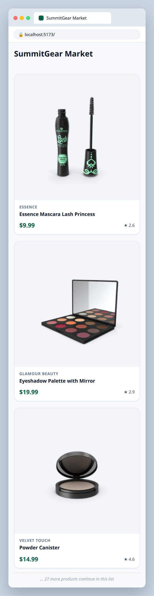

# 1.2 — Render the product grid with .map

**Labels:** feature, lists, map, day-1

## Branch
Before starting, create your branch:
```
git checkout -b product-grid
```

## Description
One card isn't a store. Use `.map` to render **every** product in `src/data/products.ts` as a `ProductCard`, laid out in a responsive grid.

Some products are running low. Add a small badge to `ProductCard` so shoppers can see it.

## Where the data comes from
Product data lives in a local file that's already in the repo: **`src/data/products.ts`** (30 products).
Import it in `App.tsx`:
```ts
import { products } from "./data/products";
```
Each product's shape is the `Product` type in **`src/types/product.ts`** — import it wherever you need to type a prop:
```ts
import type { Product } from "../types/product";
```
You'll keep using this file through Day 4. On Day 5 (ticket 5.1) you'll swap it for a real API call.

## Where your files go
```
src/
├── components/
│   ├── ProductCard.tsx   ◀━━ ✎ EDIT: change this file
│   └── ProductGrid.tsx   ◀━━ ★ NEW: create this file
├── data/
│   └── products.ts       (already here, don't change it)
├── types/
│   └── product.ts        (already here, don't change it)
└── App.tsx               ◀━━ ✎ EDIT: change this file
```
> **★ NEW** = create this file  ·  **✎ EDIT** = change a file that already exists  ·  `...` = your other components from earlier tickets

## Mock
Match the layout and pieces. Exact colors and spacing are up to you, but keep it consistent with your earlier tickets.

**Desktop: 4 columns, note the Low stock badge**



**Mobile: 1 column**



## Acceptance Criteria
- [ ] `src/components/ProductGrid.tsx` takes `products: Product[]` as a prop and maps over it
- [ ] Each `ProductCard` has a `key` using the product's `id` (no key warnings in the console)
- [ ] Grid is responsive: 1 column on mobile, 2 on tablet, 4 on desktop (`grid-cols-1 md:grid-cols-2 lg:grid-cols-4`)
- [ ] `ProductCard` shows a **"Low stock"** badge when `stock` is under 10, and nothing otherwise
- [ ] `App.tsx` renders `<ProductGrid products={products} />` instead of the single card

## Submit
When your acceptance criteria are all checked off:
```
git add .
git commit -m "your message here"
git push origin product-grid
```
Your commit message should summarize what you actually changed (not just "done" or "fix") — write it like you're telling a teammate what this branch does.

Then open a Pull Request on your own fork's GitHub page (base: your `main`, compare: your branch) and add **your-instructor-github-username** as a reviewer.
