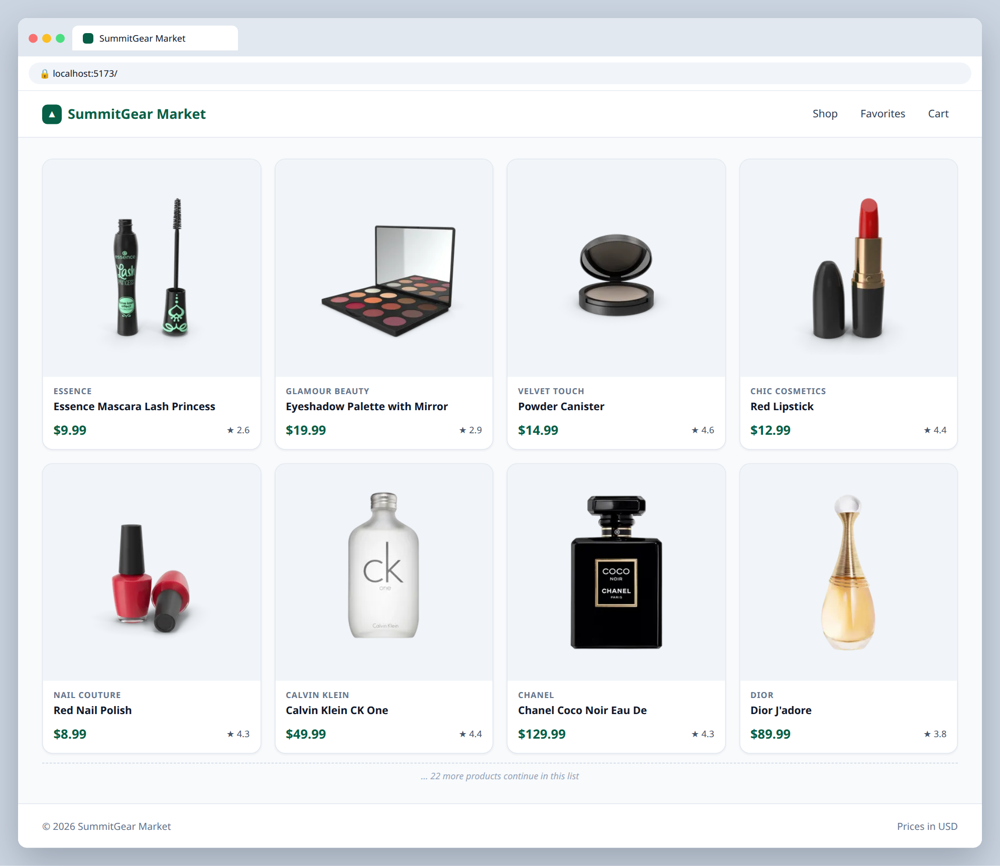

# 1.3 — Navbar and footer

**Labels:** feature, components, map, day-1

## Branch
Before starting, create your branch:
```
git checkout -b navbar-and-footer
```

## Description
Give the store a frame. Build a `Navbar` and a `Footer`.

The nav links should **not** be hard-coded one by one — store them in an array and `.map` over it. (They don't need to go anywhere yet. On Day 6 they become real routes.)

## Where your files go
```
src/
├── components/
│   ├── Footer.tsx        ◀━━ ★ NEW: create this file
│   ├── Navbar.tsx        ◀━━ ★ NEW: create this file
│   ├── ProductCard.tsx   (already here)
│   └── ProductGrid.tsx   (already here)
└── App.tsx               ◀━━ ✎ EDIT: change this file
```
> **★ NEW** = create this file  ·  **✎ EDIT** = change a file that already exists  ·  `...` = your other components from earlier tickets

## Mock
Match the layout and pieces. Exact colors and spacing are up to you, but keep it consistent with your earlier tickets.



## Acceptance Criteria
- [ ] `src/components/Navbar.tsx` shows the store name and a list of links mapped from an array like `[{ label: "Shop", href: "/" }, ...]`
- [ ] Links include at least: Shop, Favorites, Cart
- [ ] `src/components/Footer.tsx` shows `© {current year} SummitGear Market` — the year comes from `new Date().getFullYear()`, not typed in
- [ ] Footer takes the company name as a typed prop
- [ ] Both are rendered in `App.tsx` around the product grid

## Submit
When your acceptance criteria are all checked off:
```
git add .
git commit -m "your message here"
git push origin navbar-and-footer
```
Your commit message should summarize what you actually changed (not just "done" or "fix") — write it like you're telling a teammate what this branch does.

Then open a Pull Request on your own fork's GitHub page (base: your `main`, compare: your branch) and add **your-instructor-github-username** as a reviewer.
