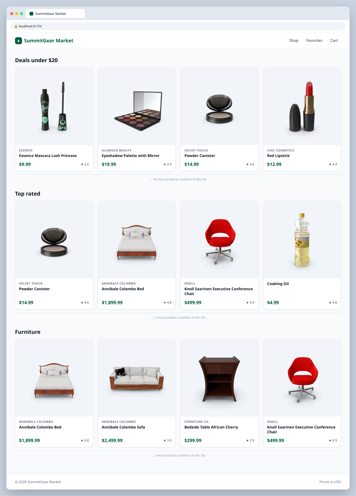

# 2.1 — Filtered product sections

**Labels:** feature, filter, day-2

## Branch
Before starting, create your branch:
```
git checkout -b filtered-sections
```

## Description
Marketing wants curated sections on the homepage. Use `.filter` to build them from the same product list — **don't** create new data arrays by hand.

## Where the data comes from
Product data lives in a local file that's already in the repo: **`src/data/products.ts`** (30 products).
Import it in `App.tsx`:
```ts
import { products } from "./data/products";
```
Each product's shape is the `Product` type in **`src/types/product.ts`** — import it wherever you need to type a prop:
```ts
import type { Product } from "../types/product";
```
You'll keep using this file through Day 4. On Day 5 (ticket 5.1) you'll swap it for a real API call.

## Where your files go
```
src/
├── components/
│   ├── ProductSection.tsx   ◀━━ ★ NEW: create this file
│   └── ...
├── data/
│   └── products.ts          (already here, don't change it)
├── types/
│   └── product.ts           (already here, don't change it)
└── App.tsx                  ◀━━ ✎ EDIT: change this file
```
> **★ NEW** = create this file  ·  **✎ EDIT** = change a file that already exists  ·  `...` = your other components from earlier tickets

## Mock
Match the layout and pieces. Exact colors and spacing are up to you, but keep it consistent with your earlier tickets.



## Acceptance Criteria
- [ ] A **"Deals under $20"** section shows only products with `price < 20`
- [ ] A **"Top rated"** section shows only products that are in stock **and** have `rating >= 4.5` (two conditions in one filter)
- [ ] A **"Furniture"** section shows only products where `category` is `"furniture"`
- [ ] Each section reuses `ProductGrid` and has a heading
- [ ] Original `products` array is never modified

## Hints
- `.filter` returns a **new** array — save it in a variable, then pass it to `ProductGrid`.
- Consider a small `ProductSection` component that takes a `title` and `products` so you aren't repeating markup.

## Submit
When your acceptance criteria are all checked off:
```
git add .
git commit -m "your message here"
git push origin filtered-sections
```
Your commit message should summarize what you actually changed (not just "done" or "fix") — write it like you're telling a teammate what this branch does.

Then open a Pull Request on your own fork's GitHub page (base: your `main`, compare: your branch) and add **your-instructor-github-username** as a reviewer.
