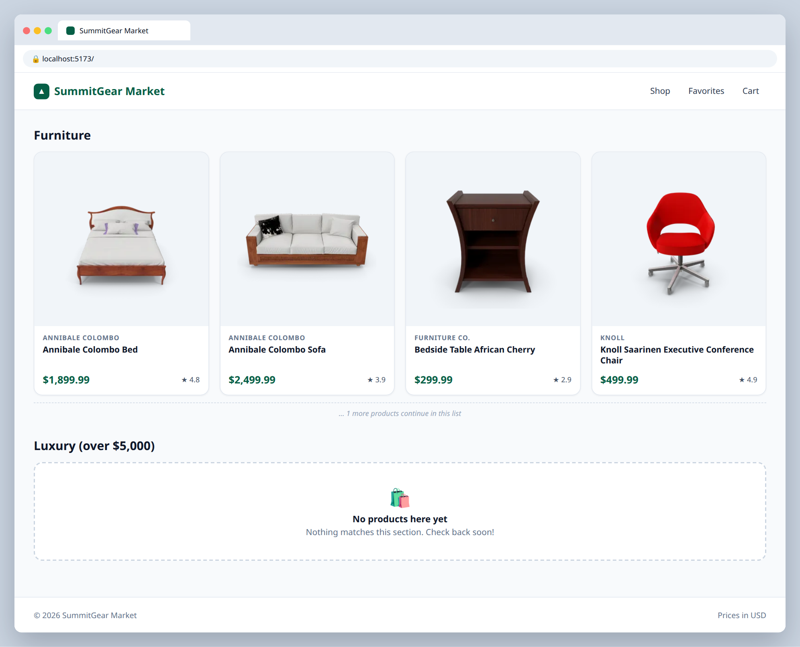

# 2.2 — Empty state component

**Labels:** feature, conditional-rendering, day-2

## Branch
Before starting, create your branch:
```
git checkout -b empty-state
```

## Description
What happens when a filter matches nothing? Right now you'd get a heading and a blank space. Build an `EmptyState` component and show it whenever a list is empty.

## Where the data comes from
Product data lives in a local file that's already in the repo: **`src/data/products.ts`** (30 products).
Import it in `App.tsx`:
```ts
import { products } from "./data/products";
```
Each product's shape is the `Product` type in **`src/types/product.ts`** — import it wherever you need to type a prop:
```ts
import type { Product } from "../types/product";
```
You'll keep using this file through Day 4. On Day 5 (ticket 5.1) you'll swap it for a real API call.

## Where your files go
```
src/
├── components/
│   ├── EmptyState.tsx    ◀━━ ★ NEW: create this file
│   ├── ProductGrid.tsx   ◀━━ ✎ EDIT: change this file
│   └── ...
├── data/
│   └── products.ts       (already here, don't change it)
├── types/
│   └── product.ts        (already here, don't change it)
└── App.tsx               ◀━━ ✎ EDIT: change this file
```
> **★ NEW** = create this file  ·  **✎ EDIT** = change a file that already exists  ·  `...` = your other components from earlier tickets

## Mock
Match the layout and pieces. Exact colors and spacing are up to you, but keep it consistent with your earlier tickets.



## Acceptance Criteria
- [ ] `src/components/EmptyState.tsx` takes a `message` prop and displays it in a styled box
- [ ] `ProductGrid` renders `EmptyState` when `products.length === 0`, and the grid otherwise
- [ ] Prove it works: add a **"Luxury (over $5,000)"** section — no products match, so it should show the empty state

## Submit
When your acceptance criteria are all checked off:
```
git add .
git commit -m "your message here"
git push origin empty-state
```
Your commit message should summarize what you actually changed (not just "done" or "fix") — write it like you're telling a teammate what this branch does.

Then open a Pull Request on your own fork's GitHub page (base: your `main`, compare: your branch) and add **your-instructor-github-username** as a reviewer.
