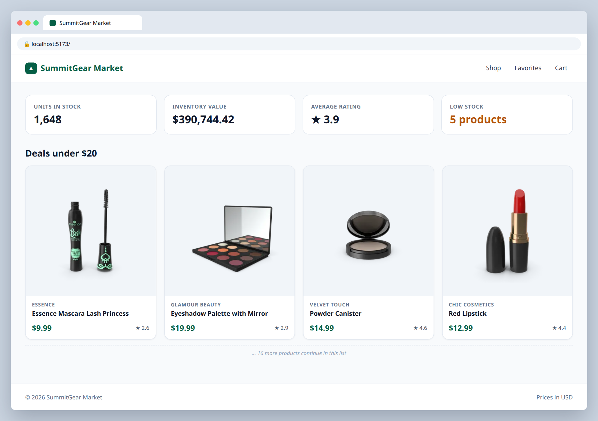

# 2.3 — Inventory stats bar

**Labels:** feature, reduce, day-2

## Branch
Before starting, create your branch:
```
git checkout -b inventory-stats
```

## Description
The store manager wants a quick summary at the top of the page. Use `.reduce` to calculate the numbers from the product list.

## Where the data comes from
Product data lives in a local file that's already in the repo: **`src/data/products.ts`** (30 products).
Import it in `App.tsx`:
```ts
import { products } from "./data/products";
```
Each product's shape is the `Product` type in **`src/types/product.ts`** — import it wherever you need to type a prop:
```ts
import type { Product } from "../types/product";
```
You'll keep using this file through Day 4. On Day 5 (ticket 5.1) you'll swap it for a real API call.

## Where your files go
```
src/
├── components/
│   ├── StatsBar.tsx   ◀━━ ★ NEW: create this file
│   └── ...
├── data/
│   └── products.ts    (already here, don't change it)
├── types/
│   └── product.ts     (already here, don't change it)
└── App.tsx            ◀━━ ✎ EDIT: change this file
```
> **★ NEW** = create this file  ·  **✎ EDIT** = change a file that already exists  ·  `...` = your other components from earlier tickets

## Mock
Match the layout and pieces. Exact colors and spacing are up to you, but keep it consistent with your earlier tickets.

**These are the real numbers your reduce code should produce**



## Acceptance Criteria
- [ ] `src/components/StatsBar.tsx` takes `products: Product[]` as a prop
- [ ] Shows **total units in stock** (sum of every `stock`) — calculated with `.reduce`
- [ ] Shows **total inventory value** (sum of `price * stock`), formatted as currency
- [ ] Shows **average rating**, rounded to 1 decimal place
- [ ] Shows the number of **low stock** products (stock under 10)
- [ ] Stats are displayed as cards in a row, rendered above the product sections

## Hints
- Always give `.reduce` a starting value: `products.reduce((sum, p) => sum + p.stock, 0)`

## Submit
When your acceptance criteria are all checked off:
```
git add .
git commit -m "your message here"
git push origin inventory-stats
```
Your commit message should summarize what you actually changed (not just "done" or "fix") — write it like you're telling a teammate what this branch does.

Then open a Pull Request on your own fork's GitHub page (base: your `main`, compare: your branch) and add **your-instructor-github-username** as a reviewer.
