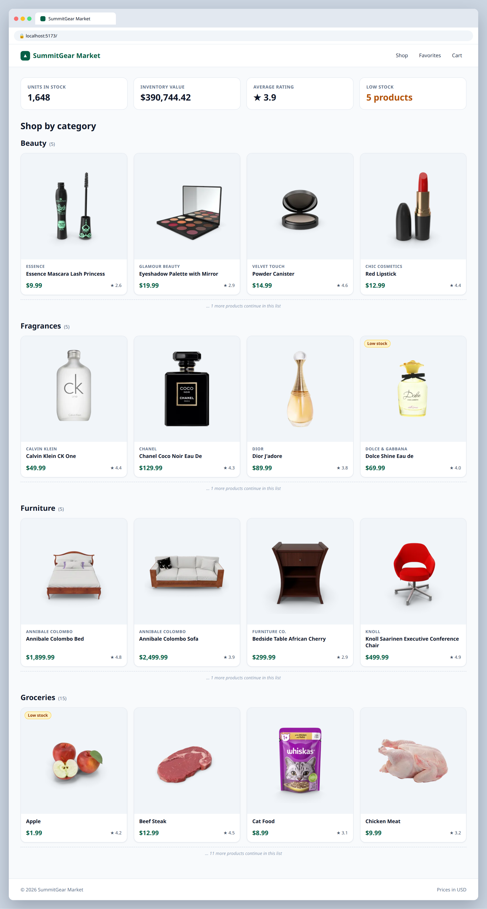

# 2.4 — Shop by category

**Labels:** feature, reduce, day-2

## Branch
Before starting, create your branch:
```
git checkout -b group-by-category
```

## Description
Instead of hard-coding one section per category, group **all** products by their `category` with `.reduce`, then render one section per group automatically.

## Where the data comes from
Product data lives in a local file that's already in the repo: **`src/data/products.ts`** (30 products).
Import it in `App.tsx`:
```ts
import { products } from "./data/products";
```
Each product's shape is the `Product` type in **`src/types/product.ts`** — import it wherever you need to type a prop:
```ts
import type { Product } from "../types/product";
```
You'll keep using this file through Day 4. On Day 5 (ticket 5.1) you'll swap it for a real API call.

## Where your files go
```
src/
├── components/
│   └── ...
├── data/
│   └── products.ts          (already here, don't change it)
├── types/
│   └── product.ts           (already here, don't change it)
├── utils/
│   └── groupByCategory.ts   ◀━━ ★ NEW: create this file
└── App.tsx                  ◀━━ ✎ EDIT: change this file
```
> **★ NEW** = create this file  ·  **✎ EDIT** = change a file that already exists  ·  `...` = your other components from earlier tickets

## Mock
Match the layout and pieces. Exact colors and spacing are up to you, but keep it consistent with your earlier tickets.



## Acceptance Criteria
- [ ] A function `groupByCategory(products)` returns an object like `{ beauty: Product[], furniture: Product[], ... }`
- [ ] Its return type is typed (e.g. `Record<string, Product[]>`)
- [ ] A **"Shop by category"** area renders one section per category using `Object.entries(...).map(...)`
- [ ] Each section heading shows the category name and how many products are in it, e.g. `Beauty (5)`
- [ ] If a new category is added to the data, it appears automatically with no code changes

## Submit
When your acceptance criteria are all checked off:
```
git add .
git commit -m "your message here"
git push origin group-by-category
```
Your commit message should summarize what you actually changed (not just "done" or "fix") — write it like you're telling a teammate what this branch does.

Then open a Pull Request on your own fork's GitHub page (base: your `main`, compare: your branch) and add **your-instructor-github-username** as a reviewer.
