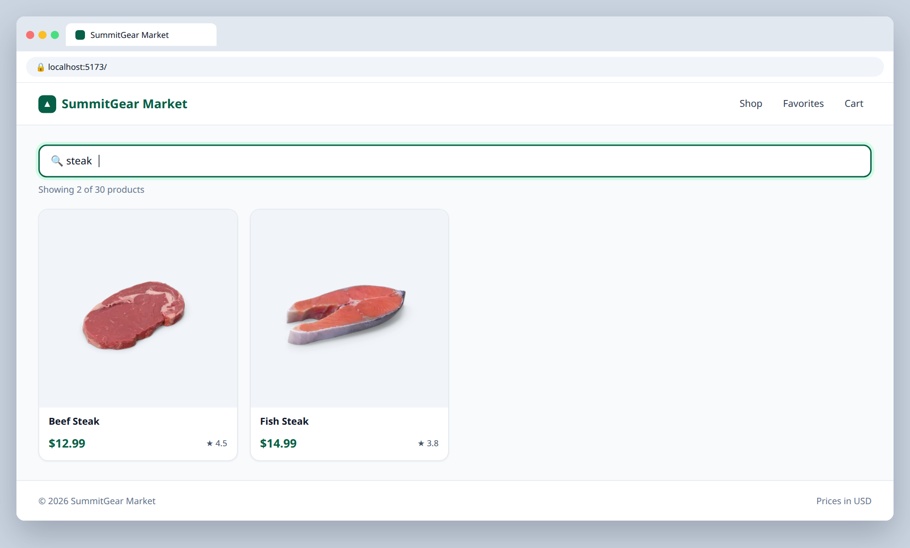
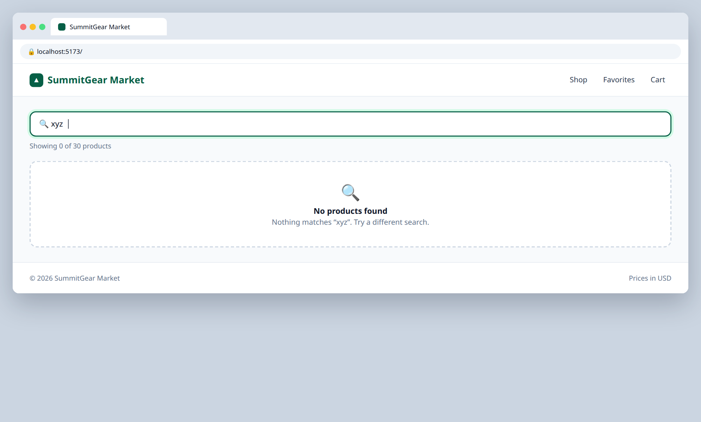

# 3.1 — Live search bar

**Labels:** feature, useState, forms, day-3

## Branch
Before starting, create your branch:
```
git checkout -b search-bar
```

## Description
Shoppers need to find things. Add a search bar that filters the product grid **as the user types**.

This combines today's `useState` with the `.filter` you wrote on Day 2.

## Where the data comes from
Product data lives in a local file that's already in the repo: **`src/data/products.ts`** (30 products).
Import it in `App.tsx`:
```ts
import { products } from "./data/products";
```
Each product's shape is the `Product` type in **`src/types/product.ts`** — import it wherever you need to type a prop:
```ts
import type { Product } from "../types/product";
```
You'll keep using this file through Day 4. On Day 5 (ticket 5.1) you'll swap it for a real API call.

## Where your files go
```
src/
├── components/
│   ├── SearchBar.tsx   ◀━━ ★ NEW: create this file
│   └── ...
├── data/
│   └── products.ts     (already here, don't change it)
├── types/
│   └── product.ts      (already here, don't change it)
└── App.tsx             ◀━━ ✎ EDIT: change this file
```
> **★ NEW** = create this file  ·  **✎ EDIT** = change a file that already exists  ·  `...` = your other components from earlier tickets

## Mock
Match the layout and pieces. Exact colors and spacing are up to you, but keep it consistent with your earlier tickets.

**Searching "steak"**



**No matches**



## Acceptance Criteria
- [ ] `src/components/SearchBar.tsx` is a **controlled input** — its `value` comes from state and `onChange` updates it
- [ ] The search text state lives in `App` and is passed down to `SearchBar` as props (value + a setter function)
- [ ] The main product grid only shows products whose `title` contains the search text
- [ ] Search is **case-insensitive** (`"STEAK"` and `"steak"` give the same results)
- [ ] Shows how many results match, e.g. `Showing 4 of 30 products`
- [ ] When nothing matches, the `EmptyState` from 2.2 shows up

## Submit
When your acceptance criteria are all checked off:
```
git add .
git commit -m "your message here"
git push origin search-bar
```
Your commit message should summarize what you actually changed (not just "done" or "fix") — write it like you're telling a teammate what this branch does.

Then open a Pull Request on your own fork's GitHub page (base: your `main`, compare: your branch) and add **your-instructor-github-username** as a reviewer.
