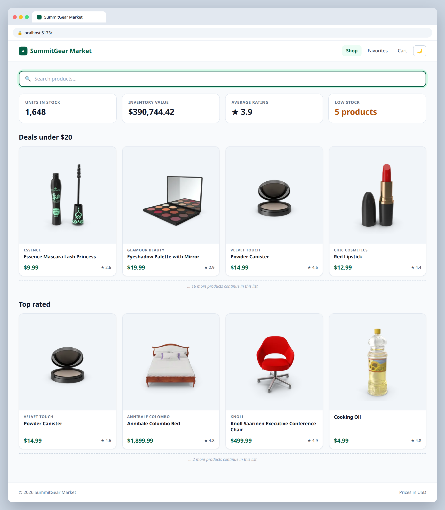
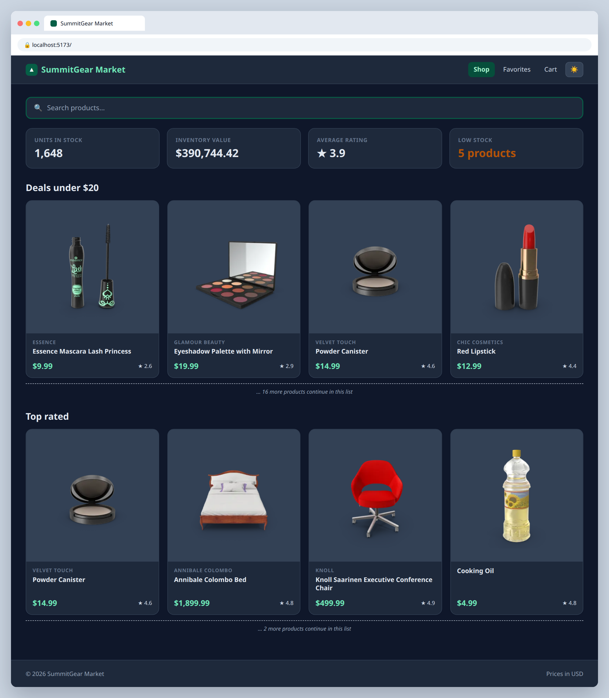

# 3.2 — Dark mode toggle

**Labels:** feature, useState, events, day-3

## Branch
Before starting, create your branch:
```
git checkout -b theme-toggle
```

## Description
Add a button to the navbar that switches the whole store between light and dark mode.

## Where your files go
```
src/
├── components/
│   ├── Navbar.tsx   ◀━━ ✎ EDIT: change this file
│   └── ...
├── App.tsx          ◀━━ ✎ EDIT: change this file
└── index.css        ◀━━ ✎ EDIT: change this file
```
> **★ NEW** = create this file  ·  **✎ EDIT** = change a file that already exists  ·  `...` = your other components from earlier tickets

## Mock
Match the layout and pieces. Exact colors and spacing are up to you, but keep it consistent with your earlier tickets.

**Light**



**Dark**



## Acceptance Criteria
- [ ] Theme state (`"light" | "dark"`) lives in `App`
- [ ] A toggle button in the `Navbar` flips the theme on click
- [ ] Button label/icon changes based on the current theme (e.g. 🌙 / ☀️)
- [ ] Background and text colors change across the page — including product cards
- [ ] Theme state is typed as a union, not `string`

## Hints
Tailwind v4 needs one line to make `dark:` classes work with a toggle. Add this to `src/index.css`:
```css
@custom-variant dark (&:where(.dark, .dark *));
```
Then put `className={theme === "dark" ? "dark" : ""}` on your outermost element and use classes like `bg-white dark:bg-gray-900`.

## Submit
When your acceptance criteria are all checked off:
```
git add .
git commit -m "your message here"
git push origin theme-toggle
```
Your commit message should summarize what you actually changed (not just "done" or "fix") — write it like you're telling a teammate what this branch does.

Then open a Pull Request on your own fork's GitHub page (base: your `main`, compare: your branch) and add **your-instructor-github-username** as a reviewer.
