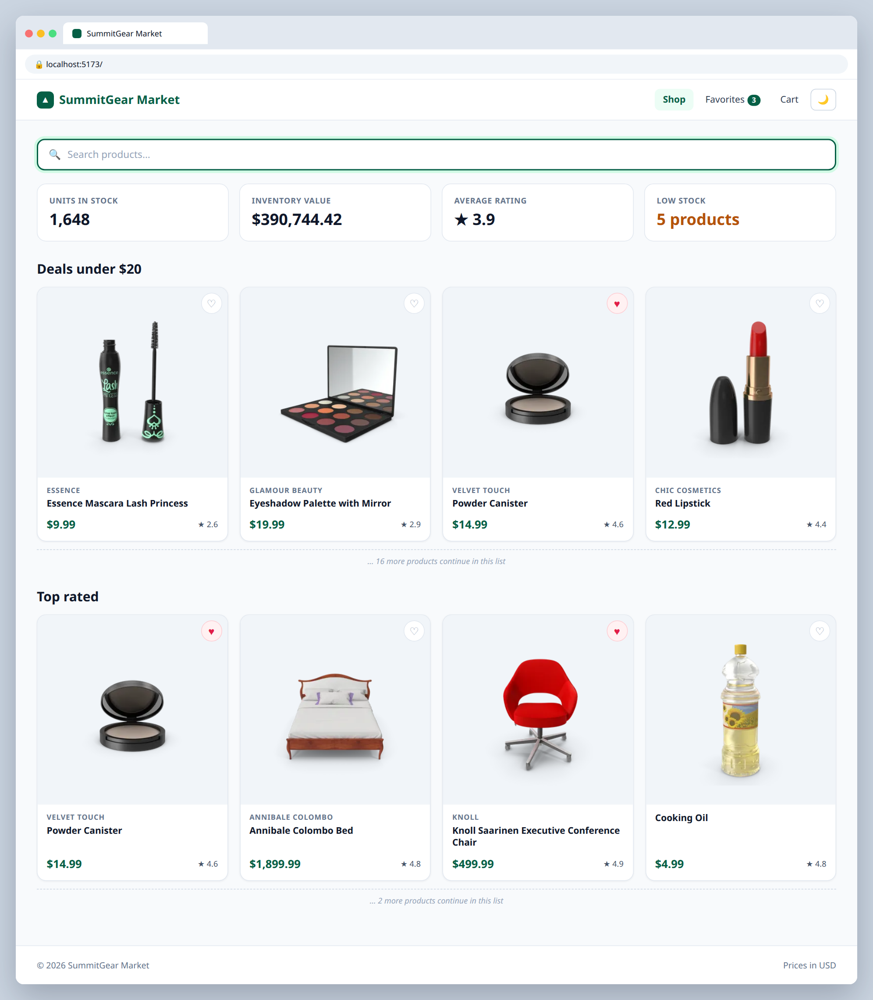

# 3.3 — Favorite products

**Labels:** feature, useState, events, day-3

## Branch
Before starting, create your branch:
```
git checkout -b favorite-toggle
```

## Description
Let shoppers favorite products with a heart button on each card.

## Where the data comes from
Product data lives in a local file that's already in the repo: **`src/data/products.ts`** (30 products).
Import it in `App.tsx`:
```ts
import { products } from "./data/products";
```
Each product's shape is the `Product` type in **`src/types/product.ts`** — import it wherever you need to type a prop:
```ts
import type { Product } from "../types/product";
```
You'll keep using this file through Day 4. On Day 5 (ticket 5.1) you'll swap it for a real API call.

## Where your files go
```
src/
├── components/
│   ├── Navbar.tsx        ◀━━ ✎ EDIT: change this file
│   ├── ProductCard.tsx   ◀━━ ✎ EDIT: change this file
│   ├── ProductGrid.tsx   ◀━━ ✎ EDIT: change this file
│   └── ...
├── data/
│   └── products.ts       (already here, don't change it)
├── types/
│   └── product.ts        (already here, don't change it)
└── App.tsx               ◀━━ ✎ EDIT: change this file
```
> **★ NEW** = create this file  ·  **✎ EDIT** = change a file that already exists  ·  `...` = your other components from earlier tickets

## Mock
Match the layout and pieces. Exact colors and spacing are up to you, but keep it consistent with your earlier tickets.

**3 favorites, count in the navbar**



## Acceptance Criteria
- [ ] Each `ProductCard` has a heart button: ♡ when not favorited, ♥ when favorited
- [ ] Favorites are stored in `App` as an array of product ids (`number[]`)
- [ ] Clicking the heart adds the id if it's not there and removes it if it is
- [ ] Favorites state is updated **without mutating** the array (no `.push` / `.splice` on state)
- [ ] The Navbar's Favorites link shows a count, e.g. `Favorites (3)`

## Hints
- Remove: `favorites.filter((id) => id !== product.id)` · Add: `[...favorites, product.id]`
- `ProductCard` needs two new props: `isFavorite: boolean` and `onToggleFavorite: () => void`.

## Submit
When your acceptance criteria are all checked off:
```
git add .
git commit -m "your message here"
git push origin favorite-toggle
```
Your commit message should summarize what you actually changed (not just "done" or "fix") — write it like you're telling a teammate what this branch does.

Then open a Pull Request on your own fork's GitHub page (base: your `main`, compare: your branch) and add **your-instructor-github-username** as a reviewer.
