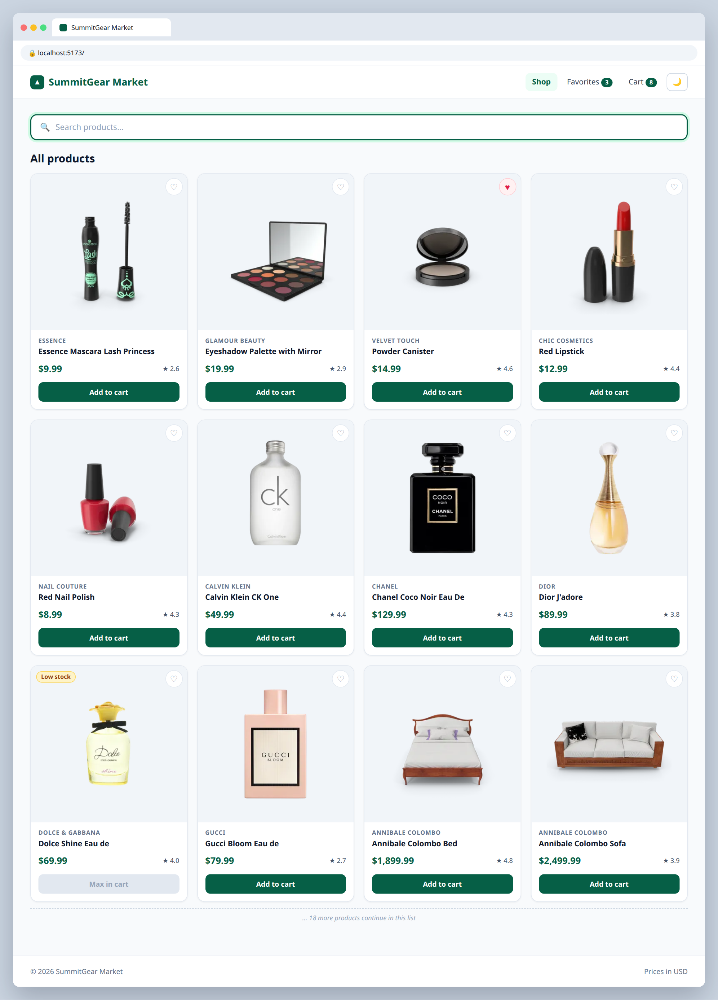

# 4.1 — Add to cart

**Labels:** feature, useState, day-4

## Branch
Before starting, create your branch:
```
git checkout -b add-to-cart
```

## Description
Time to actually sell something. Add an **Add to cart** button to each product card.

The cart is an array of objects in state, not just ids, because each item needs a quantity.

## Where the data comes from
Product data lives in a local file that's already in the repo: **`src/data/products.ts`** (30 products).
Import it in `App.tsx`:
```ts
import { products } from "./data/products";
```
Each product's shape is the `Product` type in **`src/types/product.ts`** — import it wherever you need to type a prop:
```ts
import type { Product } from "../types/product";
```
You'll keep using this file through Day 4. On Day 5 (ticket 5.1) you'll swap it for a real API call.

## Where your files go
```
src/
├── components/
│   ├── Navbar.tsx        ◀━━ ✎ EDIT: change this file
│   ├── ProductCard.tsx   ◀━━ ✎ EDIT: change this file
│   └── ...
├── data/
│   └── products.ts       (already here, don't change it)
├── types/
│   ├── cart.ts           ◀━━ ★ NEW: create this file
│   └── product.ts        (already here)
└── App.tsx               ◀━━ ✎ EDIT: change this file
```
> **★ NEW** = create this file  ·  **✎ EDIT** = change a file that already exists  ·  `...` = your other components from earlier tickets

## Mock
Match the layout and pieces. Exact colors and spacing are up to you, but keep it consistent with your earlier tickets.

**Dolce Shine has only 4 in stock and all 4 are in the cart, so its button is disabled**



## Acceptance Criteria
- [ ] A `CartItem` type exists: `{ product: Product; quantity: number }`
- [ ] Cart state (`CartItem[]`) lives in `App`
- [ ] Clicking **Add to cart** on a product not in the cart adds it with `quantity: 1`
- [ ] Clicking it on a product already in the cart increases that item's quantity by 1 (no duplicate rows)
- [ ] You can't add more than the product's `stock` — the button is disabled once you hit it
- [ ] Navbar's Cart link shows the **total number of items** (sum of quantities)

## Hints
- Update one item in an array without mutating: `cart.map((item) => item.product.id === id ? { ...item, quantity: item.quantity + 1 } : item)`

## Submit
When your acceptance criteria are all checked off:
```
git add .
git commit -m "your message here"
git push origin add-to-cart
```
Your commit message should summarize what you actually changed (not just "done" or "fix") — write it like you're telling a teammate what this branch does.

Then open a Pull Request on your own fork's GitHub page (base: your `main`, compare: your branch) and add **your-instructor-github-username** as a reviewer.
