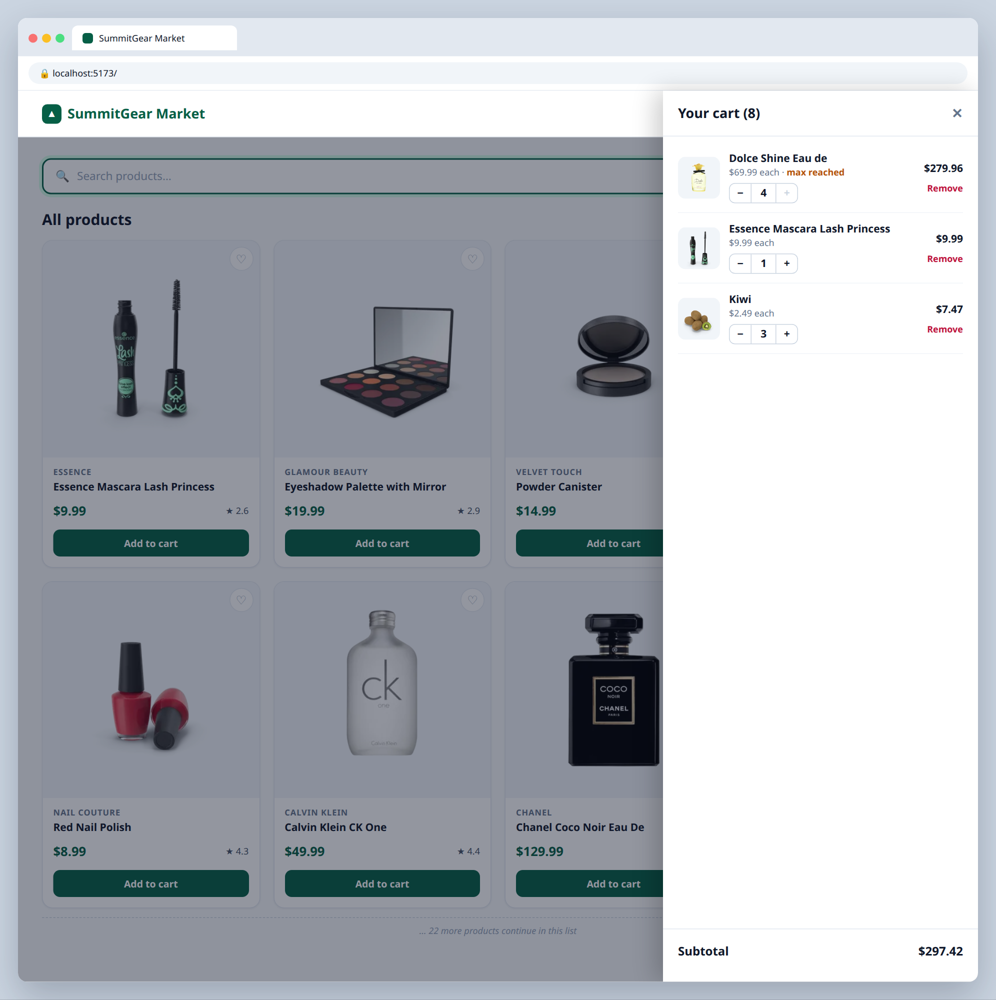
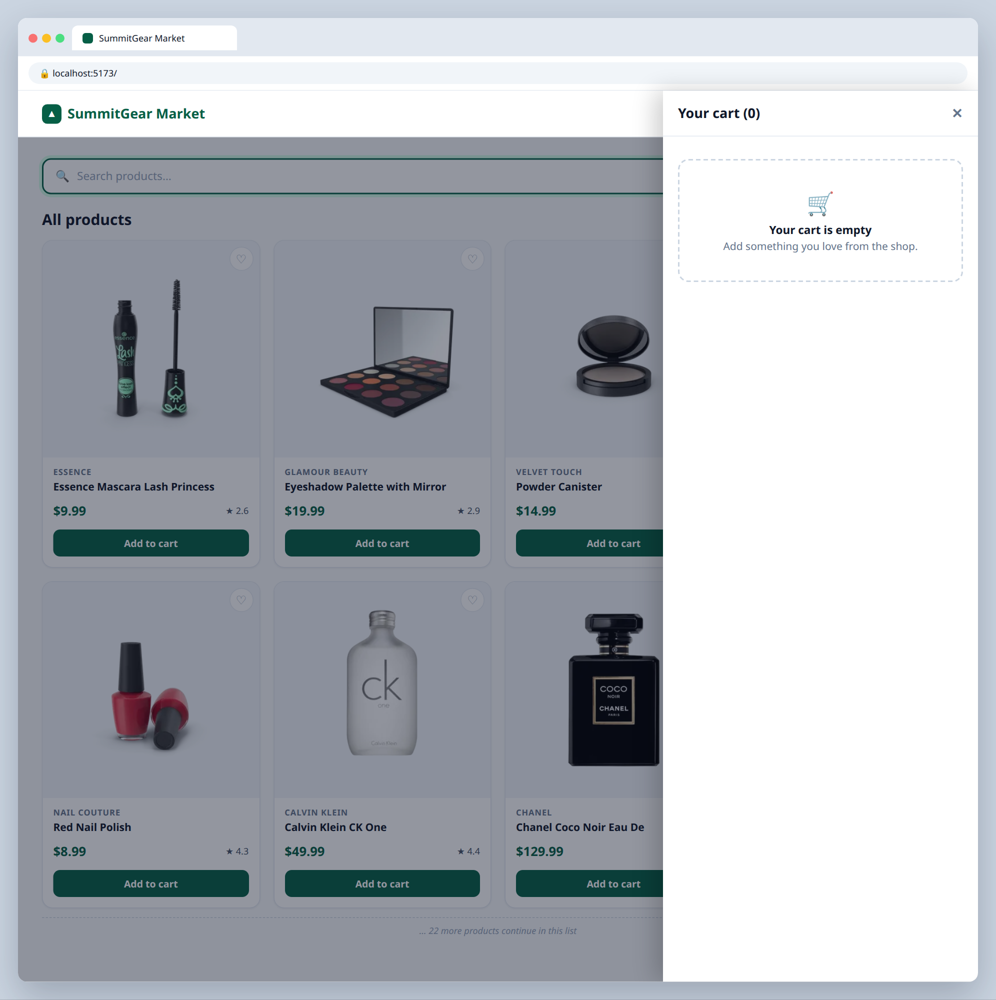

# 4.2 — Cart panel

**Labels:** feature, useState, reduce, day-4

## Branch
Before starting, create your branch:
```
git checkout -b cart-panel
```

## Description
Build a slide-out cart panel that opens when the Cart link in the navbar is clicked.

## Where your files go
```
src/
├── components/
│   ├── CartPanel.tsx   ◀━━ ★ NEW: create this file
│   ├── Navbar.tsx      ◀━━ ✎ EDIT: change this file
│   └── ...
└── App.tsx             ◀━━ ✎ EDIT: change this file
```
> **★ NEW** = create this file  ·  **✎ EDIT** = change a file that already exists  ·  `...` = your other components from earlier tickets

## Mock
Match the layout and pieces. Exact colors and spacing are up to you, but keep it consistent with your earlier tickets.

**Cart open**



**Empty cart**



## Acceptance Criteria
- [ ] A `CartPanel` component opens/closes from a boolean in state
- [ ] Lists every cart item with thumbnail, title, price, and quantity
- [ ] **+** and **−** buttons change quantity; going below 1 removes the item
- [ ] A **Remove** button removes an item completely
- [ ] Shows the cart **subtotal** using `.reduce` (sum of `price * quantity`), formatted as currency
- [ ] Empty cart shows the `EmptyState` component ("Your cart is empty")

## Submit
When your acceptance criteria are all checked off:
```
git add .
git commit -m "your message here"
git push origin cart-panel
```
Your commit message should summarize what you actually changed (not just "done" or "fix") — write it like you're telling a teammate what this branch does.

Then open a Pull Request on your own fork's GitHub page (base: your `main`, compare: your branch) and add **your-instructor-github-username** as a reviewer.
