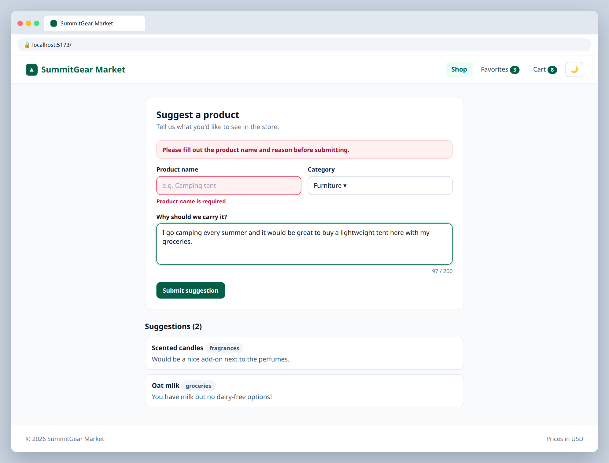

# 4.3 — "Suggest a product" form

**Labels:** feature, forms, useState, day-4

## Branch
Before starting, create your branch:
```
git checkout -b suggest-product-form
```

## Description
The store wants customer feedback. Build a form where shoppers can suggest a product they'd like to see.

## Where your files go
```
src/
├── components/
│   ├── SuggestProductForm.tsx   ◀━━ ★ NEW: create this file
│   └── ...
└── App.tsx                      ◀━━ ✎ EDIT: change this file
```
> **★ NEW** = create this file  ·  **✎ EDIT** = change a file that already exists  ·  `...` = your other components from earlier tickets

## Mock
Match the layout and pieces. Exact colors and spacing are up to you, but keep it consistent with your earlier tickets.

**Validation error on submit, live character count, submitted suggestions below**



## Acceptance Criteria
- [ ] Form has: name (text), category (select using the categories from your Day 2 grouping), and reason (textarea)
- [ ] All fields are controlled inputs, stored in **one** state object (not three `useState`s)
- [ ] Reason textarea shows a live character count and is limited to 200 characters
- [ ] Submit is blocked with an error message if name or reason is empty
- [ ] On submit: `e.preventDefault()`, the suggestion is added to a list shown below the form, and the form clears

## Hints
- One handler for every field: `setForm({ ...form, [e.target.name]: e.target.value })`

## Submit
When your acceptance criteria are all checked off:
```
git add .
git commit -m "your message here"
git push origin suggest-product-form
```
Your commit message should summarize what you actually changed (not just "done" or "fix") — write it like you're telling a teammate what this branch does.

Then open a Pull Request on your own fork's GitHub page (base: your `main`, compare: your branch) and add **your-instructor-github-username** as a reviewer.
