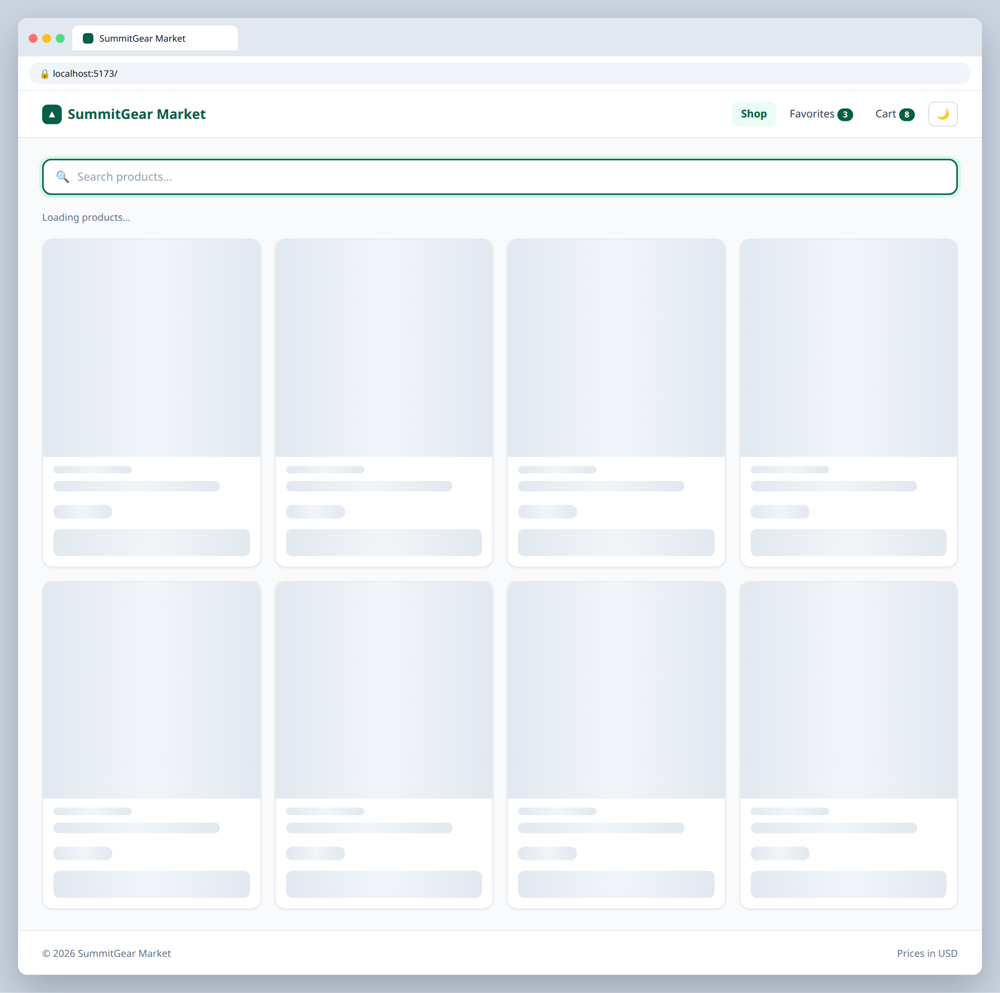
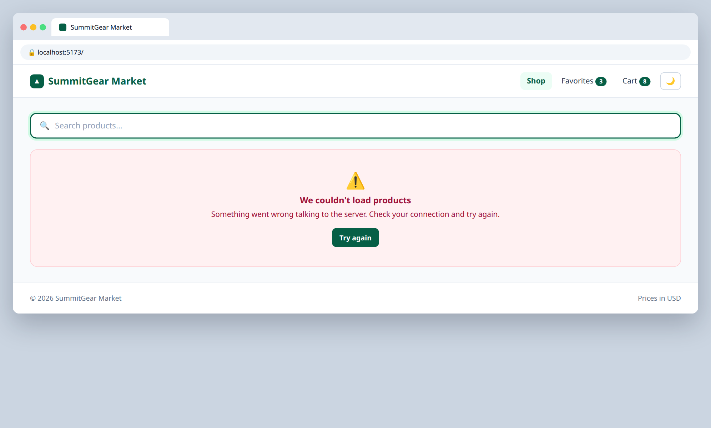

# 5.2 — Loading and error states

**Labels:** feature, useEffect, day-5

## Branch
Before starting, create your branch:
```
git checkout -b loading-and-error
```

## Description
Network requests take time and sometimes fail. Handle both.

## Mock
Match the layout and pieces. Exact colors and spacing are up to you, but keep it consistent with your earlier tickets.

**Loading**



**Error**



## Acceptance Criteria
- [ ] A `loading` boolean state is `true` while fetching and `false` after (success **or** failure)
- [ ] While loading, show a loading message or skeleton cards instead of the grid
- [ ] Fetch is wrapped in `try / catch`, and a non-OK response (`!res.ok`) is treated as an error
- [ ] On error, show a friendly error message with a **Try again** button that re-runs the fetch
- [ ] Test it: change the URL to `https://dummyjson.com/productz`, confirm the error UI, then change it back

## Submit
When your acceptance criteria are all checked off:
```
git add .
git commit -m "your message here"
git push origin loading-and-error
```
Your commit message should summarize what you actually changed (not just "done" or "fix") — write it like you're telling a teammate what this branch does.

Then open a Pull Request on your own fork's GitHub page (base: your `main`, compare: your branch) and add **your-instructor-github-username** as a reviewer.
