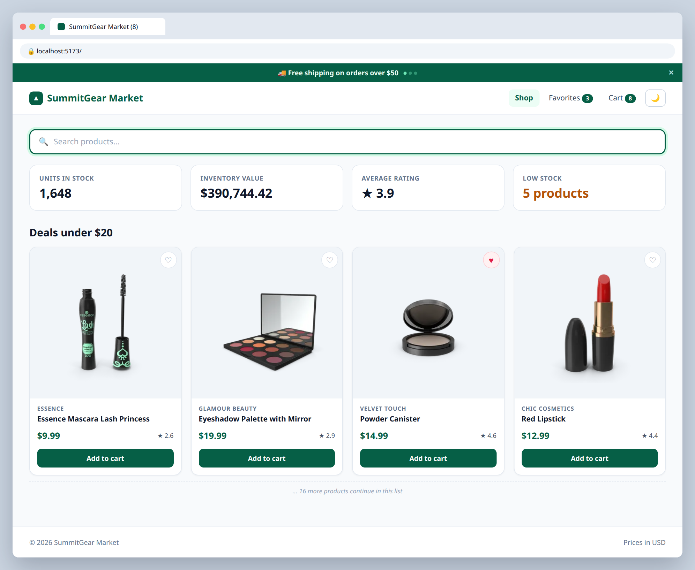

# 5.3 — Tab title sync & promo banner

**Labels:** feature, useEffect, cleanup, day-5

## Branch
Before starting, create your branch:
```
git checkout -b title-and-promo
```

## Description
Two small effects that react to state.

1. The browser tab title should always show how many items are in the cart.
2. A promo banner at the top of the page should rotate through messages every few seconds — and clean up its timer properly.

## Mock
Match the layout and pieces. Exact colors and spacing are up to you, but keep it consistent with your earlier tickets.

**Tab title shows the cart count; rotating promo banner at the top**



## Acceptance Criteria
- [ ] `document.title` updates to `SummitGear Market (3)` whenever the cart count changes — `useEffect` with the right dependency
- [ ] When the cart is empty, the title is just `SummitGear Market`
- [ ] `PromoBanner` cycles through at least 3 messages every 4 seconds using `setInterval` inside `useEffect`
- [ ] The effect **returns a cleanup** that calls `clearInterval`
- [ ] The banner has a ✕ button that hides it — and the interval stops when it's hidden (check with a `console.log`)

## Submit
When your acceptance criteria are all checked off:
```
git add .
git commit -m "your message here"
git push origin title-and-promo
```
Your commit message should summarize what you actually changed (not just "done" or "fix") — write it like you're telling a teammate what this branch does.

Then open a Pull Request on your own fork's GitHub page (base: your `main`, compare: your branch) and add **your-instructor-github-username** as a reviewer.
