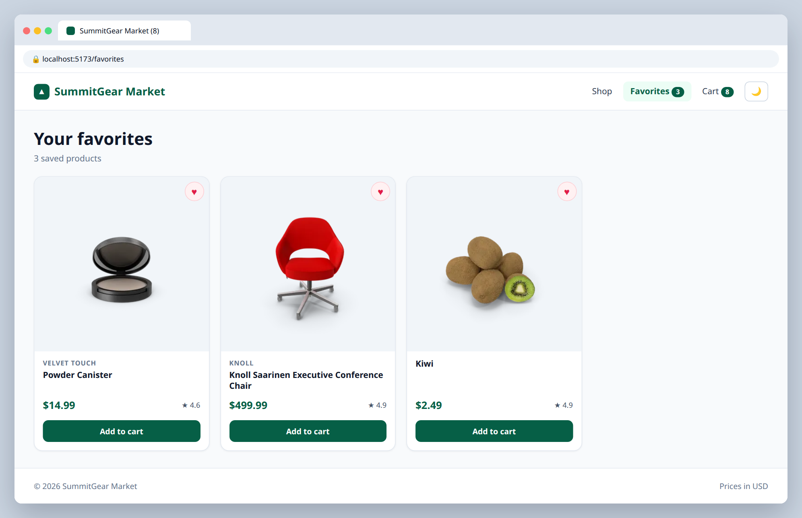
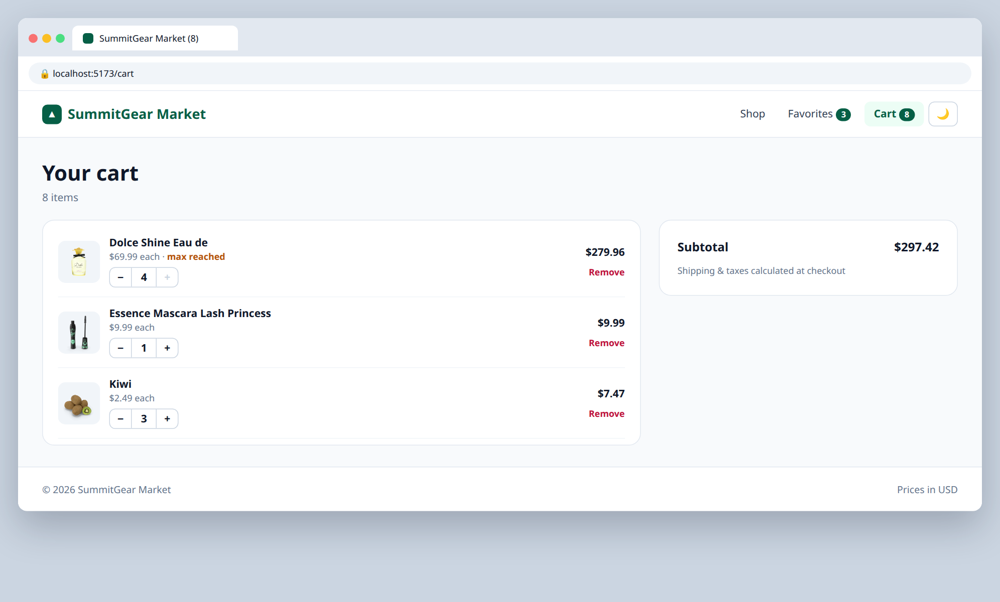

# 6.1 — Set up React Router

**Labels:** feature, routing, day-6

## Branch
Before starting, create your branch:
```
git checkout -b setup-routes
```

## Description
One giant page is getting crowded. Install React Router and split the store into pages.

```
npm i react-router
```

## Mock
Match the layout and pieces. Exact colors and spacing are up to you, but keep it consistent with your earlier tickets.

**/favorites**



**/cart**



## Acceptance Criteria
- [ ] The app is wrapped in a router (`BrowserRouter` in `main.tsx`, or `createBrowserRouter`)
- [ ] Routes exist for: `/` (Home — the product sections), `/favorites`, and `/cart`
- [ ] Each page is its own component in `src/pages/` (`HomePage.tsx`, `FavoritesPage.tsx`, `CartPage.tsx`)
- [ ] Favorites page shows only favorited products using `ProductGrid` (reuse!)
- [ ] Cart page shows what the Day 4 cart panel showed, as a full page
- [ ] Navbar links from 1.3 now use `<Link>` / `<NavLink>` instead of `<a>` — no full page reloads

## Heads up
You'll notice you have to pass cart, favorites and their setter functions through props into every page. That's annoying on purpose. Day 7 fixes it.

## Submit
When your acceptance criteria are all checked off:
```
git add .
git commit -m "your message here"
git push origin setup-routes
```
Your commit message should summarize what you actually changed (not just "done" or "fix") — write it like you're telling a teammate what this branch does.

Then open a Pull Request on your own fork's GitHub page (base: your `main`, compare: your branch) and add **your-instructor-github-username** as a reviewer.
