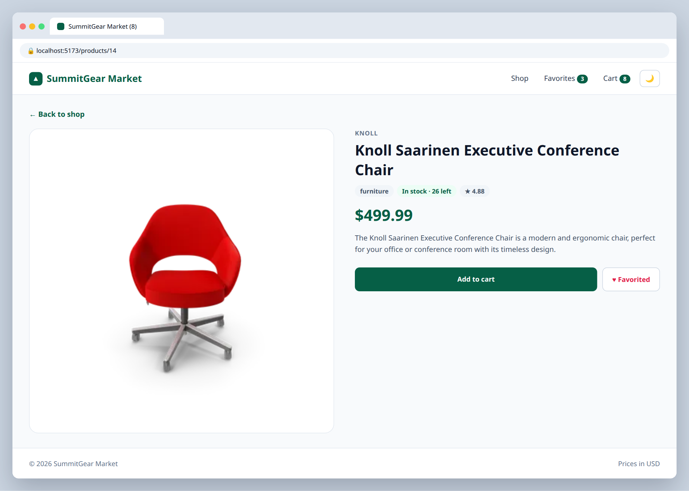
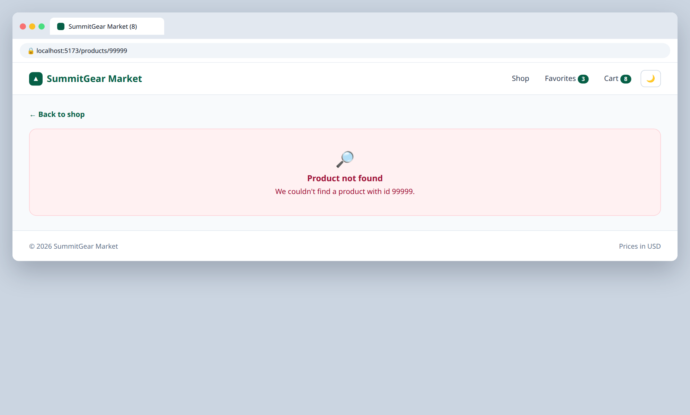

# 6.2 — Product detail page

**Labels:** feature, routing, useEffect, day-6

## Branch
Before starting, create your branch:
```
git checkout -b product-detail-page
```

## Description
Clicking a product card should open a page just for that product.

```
GET https://dummyjson.com/products/1
```

## Mock
Match the layout and pieces. Exact colors and spacing are up to you, but keep it consistent with your earlier tickets.

**/products/14**



**/products/99999**



## Acceptance Criteria
- [ ] A route `/products/:id` renders `ProductDetailPage`
- [ ] Clicking a product card's image or title navigates there
- [ ] The page reads `id` with `useParams` and fetches that single product from DummyJSON
- [ ] Shows a large image, title, brand, category, description, price, rating and stock
- [ ] Has its own loading and error states (try `/products/99999`)
- [ ] Add to cart and favorite buttons work on this page too
- [ ] A **← Back to shop** link goes back to `/`

## Submit
When your acceptance criteria are all checked off:
```
git add .
git commit -m "your message here"
git push origin product-detail-page
```
Your commit message should summarize what you actually changed (not just "done" or "fix") — write it like you're telling a teammate what this branch does.

Then open a Pull Request on your own fork's GitHub page (base: your `main`, compare: your branch) and add **your-instructor-github-username** as a reviewer.
