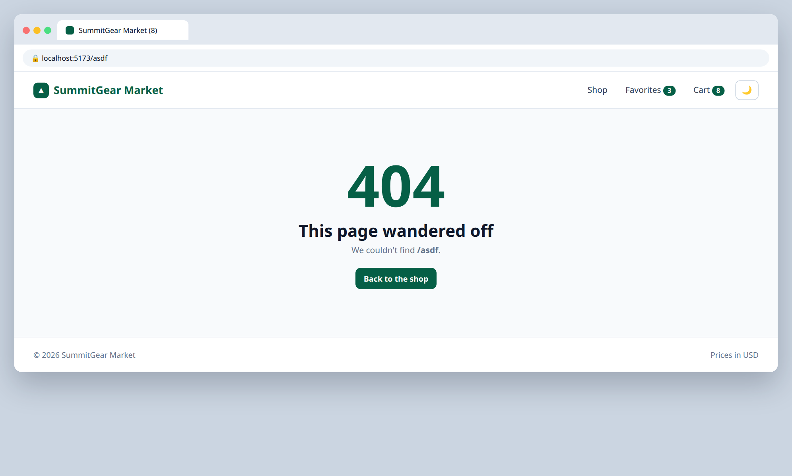

# 6.3 — Shared layout and 404 page

**Labels:** feature, routing, day-6

## Branch
Before starting, create your branch:
```
git checkout -b layout-and-404
```

## Description
Every page currently repeats the Navbar and Footer (or they're stuck outside the routes). Move them into a layout route.

## Mock
Match the layout and pieces. Exact colors and spacing are up to you, but keep it consistent with your earlier tickets.

**/asdf. Also look at the 6.1 mocks: the current page's nav link is highlighted**



## Acceptance Criteria
- [ ] A `Layout` component renders `Navbar`, then `<Outlet />`, then `Footer`
- [ ] All pages are nested inside the layout route — Navbar/Footer are written once
- [ ] The current page's nav link is visibly highlighted (`NavLink` with an active style)
- [ ] Any unknown URL (e.g. `/asdf`) shows a `NotFoundPage` with a link home (`path="*"`)

## Submit
When your acceptance criteria are all checked off:
```
git add .
git commit -m "your message here"
git push origin layout-and-404
```
Your commit message should summarize what you actually changed (not just "done" or "fix") — write it like you're telling a teammate what this branch does.

Then open a Pull Request on your own fork's GitHub page (base: your `main`, compare: your branch) and add **your-instructor-github-username** as a reviewer.
