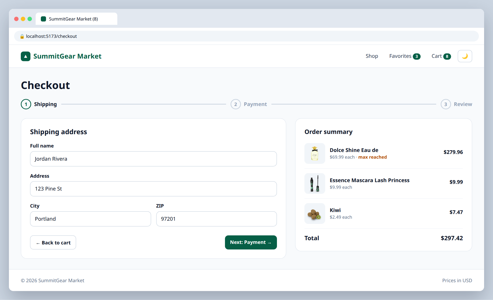
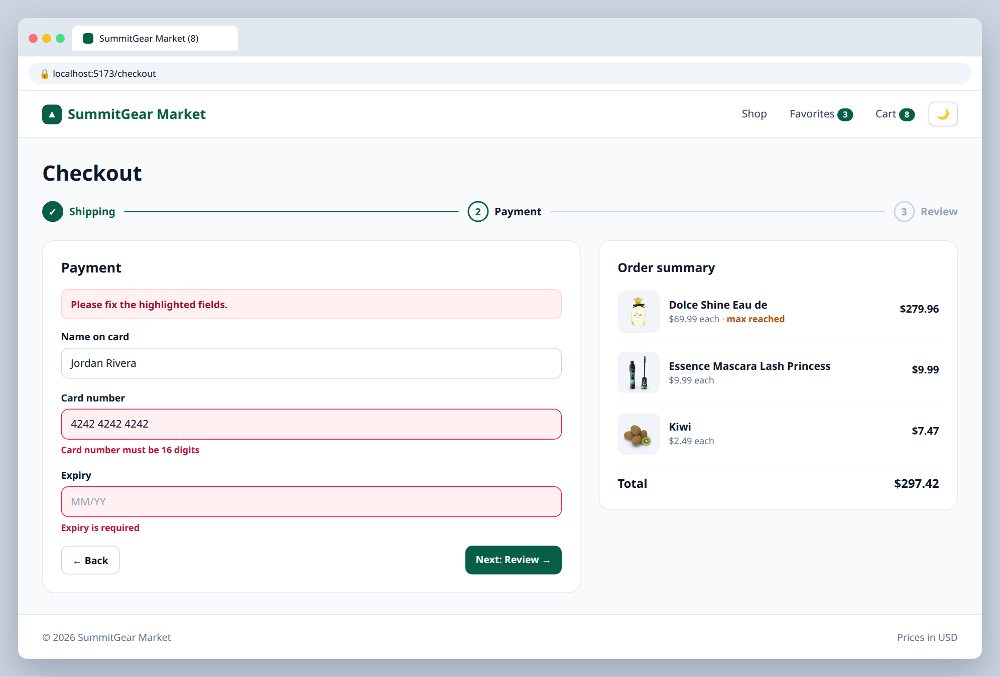
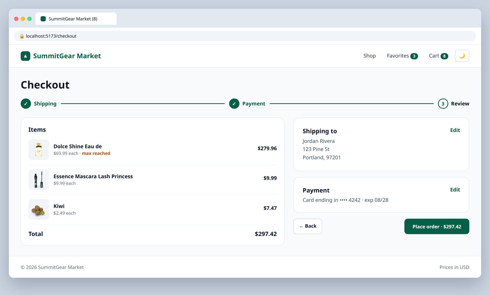

# 8.1 — Multi-step checkout

**Labels:** feature, forms, routing, global-state, day-8

## Branch
Before starting, create your branch:
```
git checkout -b checkout-flow
```

## Description
Build a checkout at `/checkout` with three steps: **Shipping → Payment → Review**. (No real payments — this is a fake form.)

## Mock
Match the layout and pieces. Exact colors and spacing are up to you, but keep it consistent with your earlier tickets.

**Step 1**



**Step 2 with validation errors**



**Step 3**



## Acceptance Criteria
- [ ] A **Checkout** button on the cart page navigates to `/checkout` (disabled when the cart is empty)
- [ ] Step 1 — Shipping: name, address, city, zip
- [ ] Step 2 — Payment: card name, card number (16 digits), expiry
- [ ] Step 3 — Review: shows the shipping info, the cart items from the store, and the total
- [ ] **Next** validates the current step and shows errors for missing/invalid fields; **Back** keeps what was typed
- [ ] A progress indicator shows which step you're on
- [ ] Form data is typed with a single `CheckoutForm` type

## Submit
When your acceptance criteria are all checked off:
```
git add .
git commit -m "your message here"
git push origin checkout-flow
```
Your commit message should summarize what you actually changed (not just "done" or "fix") — write it like you're telling a teammate what this branch does.

Then open a Pull Request on your own fork's GitHub page (base: your `main`, compare: your branch) and add **your-instructor-github-username** as a reviewer.
