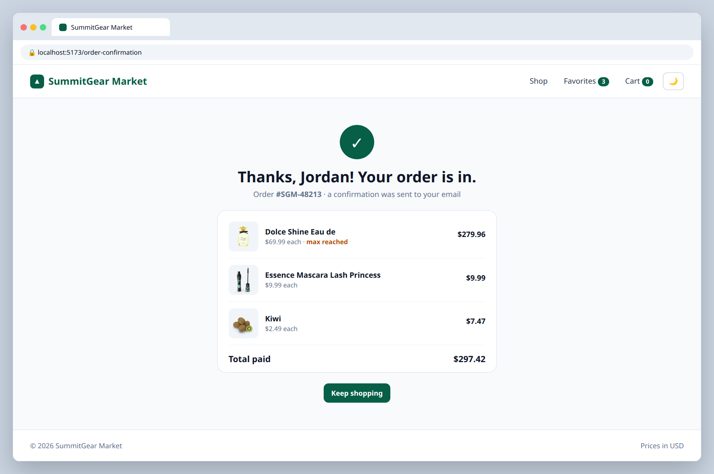

# 8.2 — Place order and confirmation page

**Labels:** feature, routing, global-state, day-8

## Branch
Before starting, create your branch:
```
git checkout -b order-confirmation
```

## Description
Finish the purchase flow.

## Mock
Match the layout and pieces. Exact colors and spacing are up to you, but keep it consistent with your earlier tickets.

**Cart badge is cleared**



## Acceptance Criteria
- [ ] **Place order** on the review step generates a fake order number and navigates to `/order-confirmation`
- [ ] Confirmation page shows the order number, items purchased and total
- [ ] The cart is cleared using `clearCart()` from the store
- [ ] Visiting `/order-confirmation` directly with no order redirects to `/` (`<Navigate>`)

## Hints
- Pass data along with navigation: `navigate("/order-confirmation", { state: order })`, then read it with `useLocation().state`.

## Submit
When your acceptance criteria are all checked off:
```
git add .
git commit -m "your message here"
git push origin order-confirmation
```
Your commit message should summarize what you actually changed (not just "done" or "fix") — write it like you're telling a teammate what this branch does.

Then open a Pull Request on your own fork's GitHub page (base: your `main`, compare: your branch) and add **your-instructor-github-username** as a reviewer.
