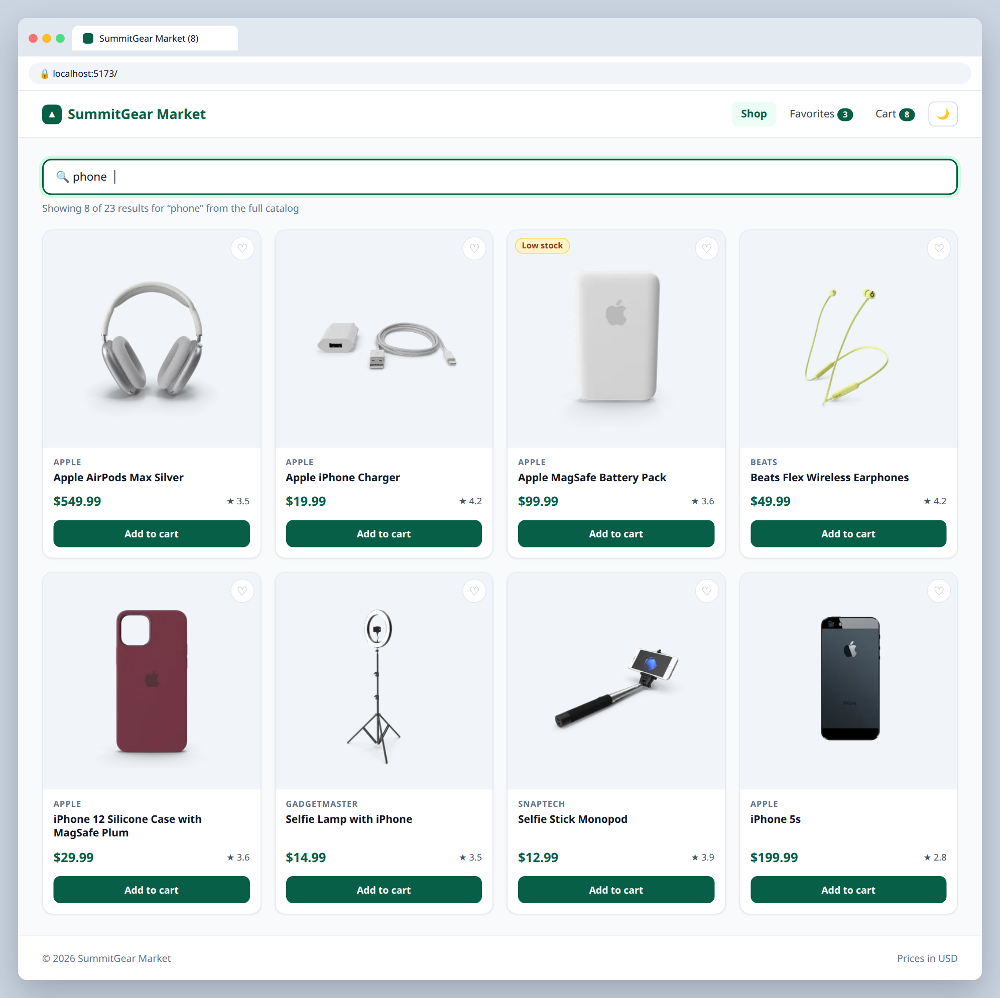

# S.1 — Search the whole catalog with debounce

**Labels:** stretch-goal, optional, custom-hooks

## Branch
Before starting, create your branch:
```
git checkout -b api-search
```

## Description
Your search only filters the 30 products you loaded. DummyJSON has 194. Search the API instead — but don't fire a request on every keystroke.

```
GET https://dummyjson.com/products/search?q=phone
```

## Mock
Match the layout and pieces. Exact colors and spacing are up to you, but keep it consistent with your earlier tickets.



## Acceptance Criteria
- [ ] A custom hook `useDebounce(value, delay)` lives in `src/hooks/useDebounce.ts`
- [ ] Search only calls the API 500ms after the user stops typing
- [ ] Results come from `/products/search?q=...` and show the loading state while fetching

## Submit
When your acceptance criteria are all checked off:
```
git add .
git commit -m "your message here"
git push origin api-search
```
Your commit message should summarize what you actually changed (not just "done" or "fix") — write it like you're telling a teammate what this branch does.

Then open a Pull Request on your own fork's GitHub page (base: your `main`, compare: your branch) and add **your-instructor-github-username** as a reviewer.
