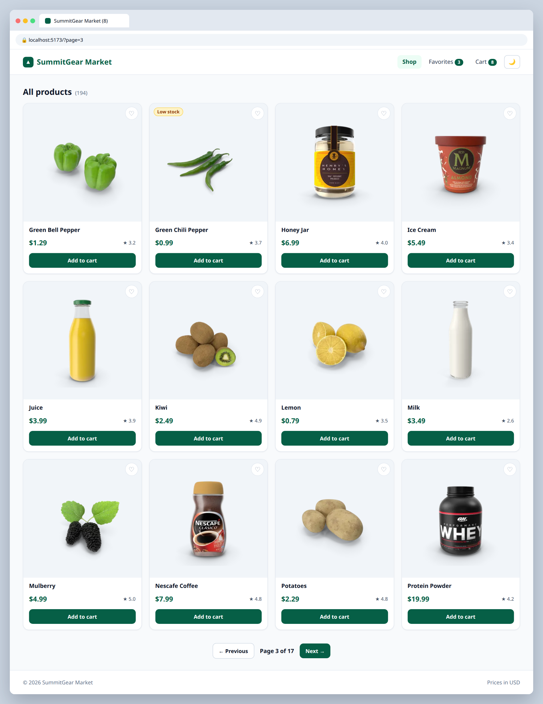

# S.2 — Pagination

**Labels:** stretch-goal, optional

## Branch
Before starting, create your branch:
```
git checkout -b pagination
```

## Description
Show all 194 products, 12 at a time.

```
GET https://dummyjson.com/products?limit=12&skip=24
```

## Mock
Match the layout and pieces. Exact colors and spacing are up to you, but keep it consistent with your earlier tickets.



## Acceptance Criteria
- [ ] **Previous** / **Next** buttons and a `Page 3 of 17` indicator
- [ ] Total pages are calculated from the API's `total` field
- [ ] Previous is disabled on page 1, Next is disabled on the last page
- [ ] The current page is in the URL (`/?page=3`) using `useSearchParams`, so refreshing keeps your place

## Submit
When your acceptance criteria are all checked off:
```
git add .
git commit -m "your message here"
git push origin pagination
```
Your commit message should summarize what you actually changed (not just "done" or "fix") — write it like you're telling a teammate what this branch does.

Then open a Pull Request on your own fork's GitHub page (base: your `main`, compare: your branch) and add **your-instructor-github-username** as a reviewer.
