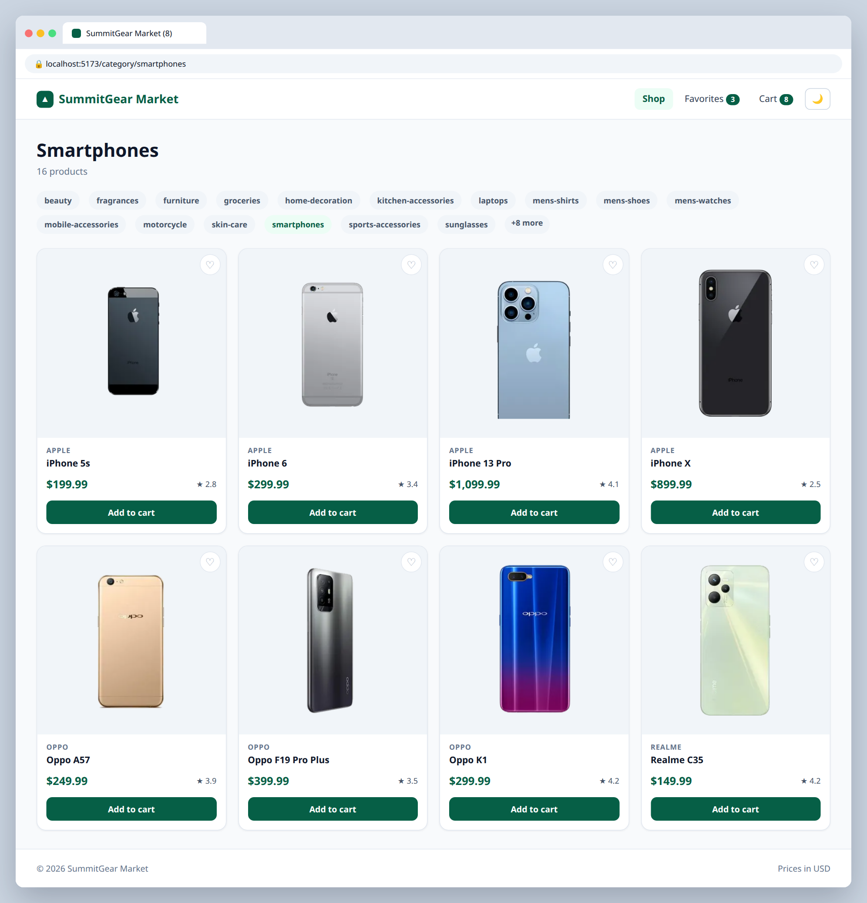

# S.3 — Category pages

**Labels:** stretch-goal, optional

## Branch
Before starting, create your branch:
```
git checkout -b category-pages
```

## Description
Give every category its own page.

```
GET https://dummyjson.com/products/category-list
GET https://dummyjson.com/products/category/smartphones
```

## Mock
Match the layout and pieces. Exact colors and spacing are up to you, but keep it consistent with your earlier tickets.



## Acceptance Criteria
- [ ] A category dropdown or sidebar is built from `/products/category-list`
- [ ] Route `/category/:slug` fetches and shows that category's products
- [ ] The Shop by category headings from 2.4 link to their category page

## Submit
When your acceptance criteria are all checked off:
```
git add .
git commit -m "your message here"
git push origin category-pages
```
Your commit message should summarize what you actually changed (not just "done" or "fix") — write it like you're telling a teammate what this branch does.

Then open a Pull Request on your own fork's GitHub page (base: your `main`, compare: your branch) and add **your-instructor-github-username** as a reviewer.
