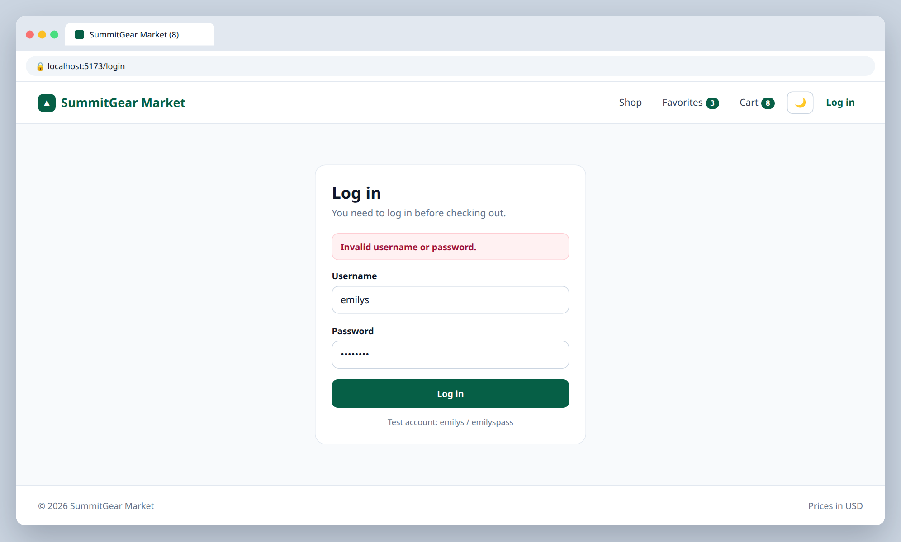
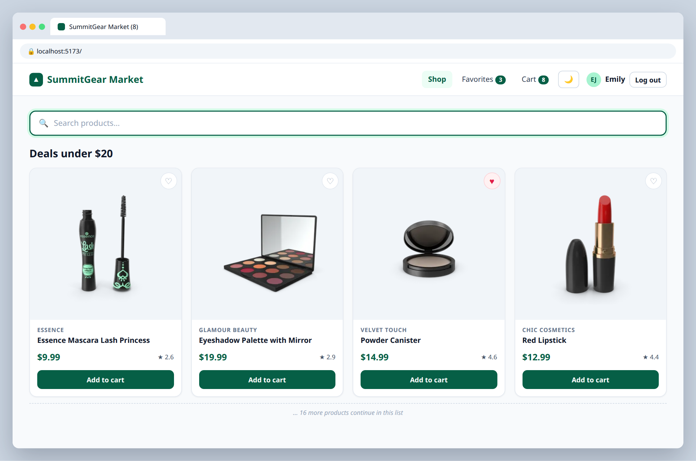

# S.4 — Login and protected routes

**Labels:** stretch-goal, optional, auth

## Branch
Before starting, create your branch:
```
git checkout -b login
```

## Description
A preview of what you'll build yourself in the backend unit. DummyJSON has a fake login that returns a real JWT.

```
POST https://dummyjson.com/auth/login
body: { "username": "emilys", "password": "emilyspass" }
```

## Mock
Match the layout and pieces. Exact colors and spacing are up to you, but keep it consistent with your earlier tickets.

**Login with an error**



**Navbar when logged in**



## Acceptance Criteria
- [ ] A `/login` page with a controlled username/password form
- [ ] On success, the `accessToken` and user info are saved in an `authStore` (Zustand, persisted)
- [ ] Navbar shows the user's name and a **Log out** button when logged in, and a **Log in** link otherwise
- [ ] `/checkout` is a **protected route** — logged-out users are redirected to `/login`
- [ ] A wrong password shows an error message

## Submit
When your acceptance criteria are all checked off:
```
git add .
git commit -m "your message here"
git push origin login
```
Your commit message should summarize what you actually changed (not just "done" or "fix") — write it like you're telling a teammate what this branch does.

Then open a Pull Request on your own fork's GitHub page (base: your `main`, compare: your branch) and add **your-instructor-github-username** as a reviewer.
